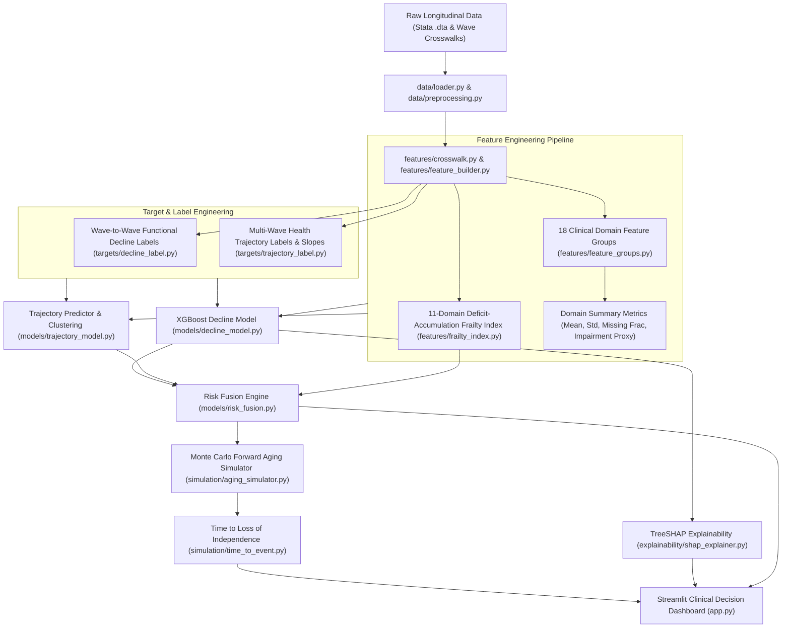

# HAALSI AI: Complete Technical & Implementation Summary

## 1. Project Overview & Objective

**HAALSI AI** is an end-to-end clinical machine learning framework, longitudinal frailty analyzer, and point-of-care clinical decision support system. It converts multi-wave longitudinal aging survey data (harmonized across longitudinal aging cohorts such as HAALSI) into an explainable, actionable predictive system for geriatric care.

### Core Capabilities Built:
1. **Multi-Domain Deficit Frailty Scoring:** Calculates an 11-domain deficit-accumulation Frailty Index ($0.0 \text{ to } 1.0$) using robust statistical normalization.
2. **Longitudinal Functional Decline Prediction:** Predicts the probability of severe multi-year functional collapse across wave transitions using cross-validated gradient boosted ensembles.
3. **Multi-Wave Trajectory Modeling:** Clusters and predicts health trajectory progression over time, identifying fast decliners vs. stable aging cohorts.
4. **Forward Aging Simulation (Time-to-Event):** Executes Monte Carlo forward perturbations (500 simulations) over horizons of 1, 3, 5, 7, and 10 years to compute the **"Estimated Time to Loss of Independence"**.
5. **Point-of-Care Clinical Interface:** An interactive Streamlit dashboard allowing healthcare providers or community workers to input patient biometric and functional markers to receive instant risk classification and clinical recommendations.

---

## 2. System Architecture & Workflow



---

## 3. Complete File & Directory Inventory

### 3.1 Root & Configuration
| File Path | Description |
| :--- | :--- |
| `main.py` | Orchestration script that triggers end-to-end model training (`run_training()`). |
| `app.py` | Interactive Streamlit web application providing a point-of-care clinical decision dashboard. |
| `config/haalsi_config.py` | Global settings, raw data paths, output directories, wave configurations (`W1, W2, W3`), and risk fusion weighting hyperparameters. |
| `requirements.txt` | Python dependencies including `pandas`, `numpy`, `scikit-learn`, `xgboost`, `shap`, `streamlit`, `pyreadstat`, and `joblib`. |

---

### 3.2 Data Ingestion & Preprocessing (`data/`)
| File Path | Description |
| :--- | :--- |
| `data/loader.py` | Fast ingestion of Stata `.dta` survey data using `pyreadstat` with memory optimization. |
| `data/preprocessing.py` | Cleans survey-specific missing codes (`-97`, `-98`, `-99` $\to$ `NaN`), performs safe numeric coercion, and standardizes column headers. |
| `data/wave_parser.py` | Parses and normalizes wave-specific prefixes and variable naming formats across survey waves. |

---

### 3.3 Feature Engineering & Registry (`features/`)
| File Path | Description |
| :--- | :--- |
| `features/crosswalk.py` | Ingests multi-sheet crosswalk workbooks, mapping variable names and survey question texts across longitudinal waves into a unified registry. |
| `features/feature_groups.py` | Defines 18 clinical/social domain definitions (Mobility, Function, Cognition, Disease, Blood Pressure, BMI, Mental Health, Social Networks, etc.) and specifies adverse clinical risk directions. |
| `features/frailty_index.py` | Implements deficit-accumulation Frailty Index calculation across 11 vulnerability domains using Median Absolute Deviation (MAD) scaling. |
| `features/feature_builder.py` | Assembles wide feature matrices per wave and computes domain-level statistics (mean health score, intra-domain variability, missingness fraction, and impairment indicators). |
| `features/trajectory_features.py` | Computes dynamic temporal transition features between survey waves. |

---

### 3.4 Target & Label Engineering (`targets/`)
| File Path | Description |
| :--- | :--- |
| `targets/decline_label.py` | Generates ground-truth binary decline labels ($y \in \{0, 1\}$) by standardizing within-domain health scores between baseline (Wave 1) and follow-up (Wave 2). |
| `targets/trajectory_label.py` | Computes multi-wave longitudinal health slopes and categorical trajectory patterns. |
| `targets/trajectory_utils.py` | Mathematical utilities for rate-of-change and slope calculations across uneven wave intervals. |

---

### 3.5 Modeling, Fusion & Explainability (`models/` & `explainability/`)
| File Path | Description |
| :--- | :--- |
| `models/decline_model.py` | Trains calibrated XGBoost/Random Forest classifiers for multi-year functional decline with Stratified K-Fold CV. |
| `models/trajectory_model.py` | Regresses longitudinal health trajectory scores from baseline clinical features. |
| `models/trajectory_clustering.py` | Unsupervised clustering of longitudinal decline trajectories to identify patient risk phenotypes. |
| `models/risk_fusion.py` | Mathematical fusion combining decline model probability ($40\%$), frailty index ($40\%$), and age ($20\%$) into categorized risk tiers (`Low`, `Moderate`, `High`). |
| `models/combined_risk.py` | Ensembling utility for multi-model score calibration. |
| `explainability/shap_explainer.py` | Implements TreeSHAP explainers to calculate feature attribution values for each patient prediction. |

---

### 3.6 Simulation & Prognostics (`simulation/`)
| File Path | Description |
| :--- | :--- |
| `simulation/aging_simulator.py` | Forward Monte Carlo simulation engine executing 500 stochastic perturbations per patient across horizons of 1, 3, 5, 7, and 10 years. |
| `simulation/time_to_event.py` | Evaluates simulated trajectory curves against a severe impairment threshold ($75\%$) to output the **Estimated Time to Loss of Independence** (in years). |

---

### 3.7 Pipelines & Inference Support (`pipeline/` & `inference/`)
| File Path | Description |
| :--- | :--- |
| `pipeline/train_pipeline.py` | End-to-end training pipeline orchestrating data loading, domain aggregation, feature extraction, model fitting, quantile scaling, and artifact serialization. |
| `pipeline/trajectory_pipeline.py` | Specialized pipeline for extracting multi-wave health metrics and fitting trajectory cluster models. |
| `inference/schema.py` | Serialization and verification of feature schemas and default population medians for robust inference on missing inputs. |
| `inference/input_mapper.py` | Aligns incoming raw clinician/user inputs with the trained model feature matrix schema. |

---

### 3.8 Serialized Outputs & Artifacts (`outputs/`)
- **Trained Models:**
  - `outputs/models/haalsi_decline_model.joblib` & `decline_model.joblib`: Trained XGBoost decline classifiers.
  - `outputs/models/trajectory_model.joblib`: Trained health trajectory regressor.
  - `outputs/models/trajectory_cluster_model.joblib`: Unsupervised trajectory clustering model.
  - `outputs/models/trajectory_scaler.joblib`: QuantileTransformer for trajectory normalization.
- **Inference Schemas & Thresholds:**
  - `outputs/artifacts/schema.json`: Complete feature column registry and population medians.
  - `outputs/artifacts/feature_columns.json`: List of expected features for inference.
  - `outputs/artifacts/feature_defaults.json`: Baseline imputers for point-of-care forms.
  - `outputs/models/trajectory_thresholds.json`: Calibrated lower and upper percentile cutoffs.

---

## 4. Current State: What Coding Has Been Done

1. **Complete Data-to-Model Pipeline:** The system successfully parses raw longitudinal survey waves, aligns disparate variable crosswalks, computes deficit frailty scores, and trains calibrated classifiers and regressors.
2. **Longitudinal Risk Fusion:** Rather than relying on a single static score, the pipeline integrates:
   $$\text{Overall Risk} = 0.40 \times P(\text{Decline}) + 0.40 \times \text{Frailty Index} + 0.20 \times \text{Age Factor}$$
3. **Prognostic Time-Horizon Simulation:** Forward Monte Carlo simulations project trajectory drift over multiple years, translating probabilities into a time horizon (*"Estimated Time to Loss of Independence: X years"*).
4. **Point-of-Care User Interface:** Streamlit UI in `app.py` allows interactive data entry with automated BMI calculation and instant risk categorization.

---

## 5. What Is Left To Do (Technical Backlog)

The core ML models and UI are functional. The following technical engineering tasks remain to elevate the system from a prototype into a robust clinical application:

```
┌────────────────────────────────────────────────────────────────────────┐
│                        TECHNICAL TASK ROADMAP                          │
├────────────────────────────────┬───────────────────────────────────────┤
│ 1. Polypharmacy Safety Engine  │ Medication count & adverse drug rules │
│ 2. Inline SHAP Visualizations  │ Real-time waterfall plots in UI       │
│ 3. Automated Alert Webhooks    │ Caregiver SMS/WhatsApp triggers       │
│ 4. Multilingual Interface      │ English/Hindi localization for ASHAs  │
│ 5. LASI Cross-Validation       │ Mapping to Indian Longitudinal Data   │
│ 6. REST API & Offline Sync     │ FastAPI backend + offline caching     │
└────────────────────────────────┴───────────────────────────────────────┘
```

### Detailed Breakdown of Remaining Work:

### Task 1: Polypharmacy & Medication Safety Engine
- **Current State:** Baseline chronic disease indicators are tracked, but concurrent medication counts and drug-drug interaction risks are unmonitored.
- **To Build:**
  - Add active medication input fields in `app.py`.
  - Implement a rules engine flagging polypharmacy ($\ge 5$ medications) and adverse drug reaction (ADR) risks (especially anticholinergic and sedative burdens known to cause falls and acute cognitive decline).

### Task 2: Inline Explainability in the UI (SHAP Integration)
- **Current State:** `explainability/shap_explainer.py` exists as a standalone module, but the Streamlit interface currently displays static text summaries.
- **To Build:**
  - Connect `TreeExplainer` directly to `app.py`.
  - Render an interactive SHAP waterfall plot or bar chart displaying the top 3–5 patient-specific risk drivers (e.g., impaired chair rise, high systolic BP, memory deficit) during each clinical evaluation.

### Task 3: Caregiver & Frontline Alert Automation
- **Current State:** The UI displays risk tiers (`Low`, `Moderate`, `High`), but does not trigger external notifications.
- **To Build:**
  - Build a webhook/notification dispatcher in Python to generate automated alerts (e.g., SMS/WhatsApp via Twilio or local gateway) when a patient enters the `High Risk` or rapid decline category.
  - Generate a downloadable "Caregiver Action Plan" PDF with personalized non-pharmacological interventions.

### Task 4: Multilingual & Low-Literacy Support for Frontline Workers
- **Current State:** The interface is currently English-only and uses clinical terminology.
- **To Build:**
  - Implement a language toggle in Streamlit (e.g., English / Hindi / regional dialects) tailored for frontline health workers (ASHAs/ANMs).
  - Add simplified pictorial/iconographic inputs for functional assessments (e.g., illustrations for chair rise ability, walking assistance, and stair climbing).

### Task 5: Indian Cohort Domain Mapping (LASI Integration)
- **Current State:** Feature extraction is tuned to the HAALSI wave crosswalks.
- **To Build:**
  - Map the domain definitions in `features/feature_groups.py` to the **Longitudinal Ageing Study in India (LASI)** survey variable schema.
  - Verify that the 11 frailty domains and cognitive recall tests map cleanly to LASI Wave 1/2 public data.

### Task 6: API Decoupling & Offline Sync Support
- **Current State:** Inference runs directly inside the Streamlit runtime.
- **To Build:**
  - Decouple model inference into a lightweight **FastAPI** service (`/predict_risk`, `/simulate_trajectory`).
  - Provide local SQLite/IndexedDB caching so frontline health workers in rural areas with spotty connectivity can enter records offline and sync when connected.
